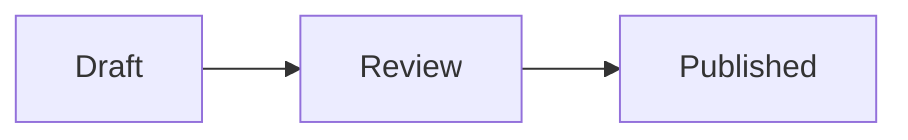

# M Note

A markdown editor built with Electron, React, and Tiptap.


## Download

Download the latest release from the [GitHub Releases](https://github.com/younghoandrewchaa/m-note/releases) page.

- **macOS** — download the `.dmg` file
- **Windows** — download the `.exe` setup file

### Windows: SmartScreen warning

The Windows installer is not code-signed yet, so Windows SmartScreen may show a warning on first launch. To proceed:

1. Click **"More info"**
2. Click **"Run anyway"**

## Development

```bash
npm start
```

## Scripts

### Release

```bash
npm run release
# or with a custom release note:
npm run release -- "What's new in this release"
```

Requires a clean working tree.

Runs locally and triggers CI to build and publish:

1. **Preflight** — checks there are no uncommitted changes
2. **Version bump** — increments the patch number in `package.json` / `package-lock.json`
3. **Commit & tag** — commits the version files and creates a `vX.Y.Z` git tag
4. **Push** — pushes the commit and tag to remote, which triggers the CI workflow
5. **CI** — builds the signed/notarized DMG and publishes the GitHub release

If a release note is passed, it becomes the GitHub release body verbatim. Otherwise CI auto-generates notes from the git commit log since the previous tag.

### Build DMG (local only)

```bash
npm run build:dmg
```

Builds the DMG without bumping the version or publishing. Useful for local testing.


## Mermaid diagrams

Choose **Mermaid** in a code block's language selector, or open Markdown containing a Mermaid fence:

````markdown

````

The source stays editable with a live diagram below it. Previews update after a short typing pause, match the light/dark theme, and work offline. Saving and **Copy Markdown** keep the original Mermaid source, not the generated SVG.

Invalid or oversized diagrams show an error without discarding source. If an earlier valid preview remains visible, it is marked as stale. Diagram links and external images are disabled.

Rendering uses [Pele](https://pele.run/), whose layout differs from Mermaid.js. Mermaid theme colours, arbitrary HTML labels, and external Mermaid plugins are not supported; see [Pele's compatibility guide](https://pele.run/compatibility).
